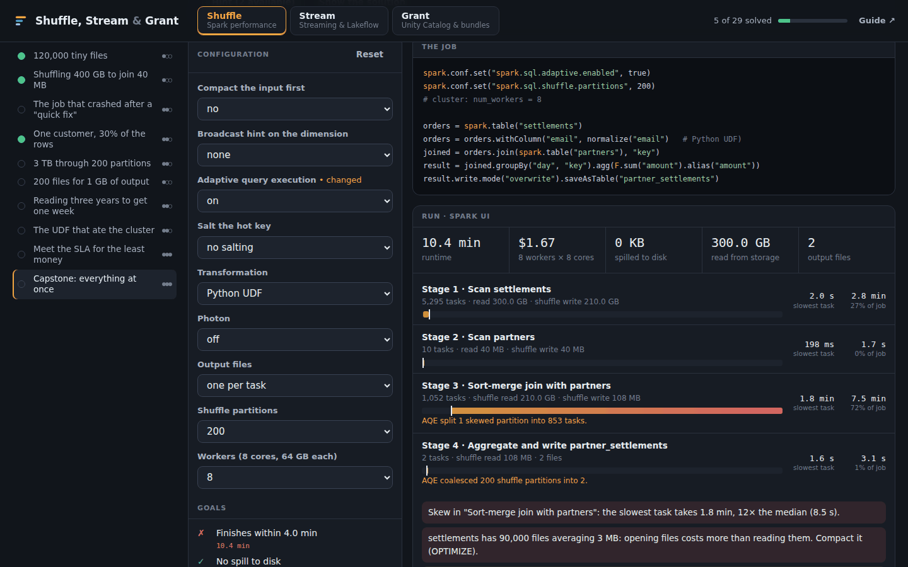

# Shuffle, Stream & Grant

**Hands-on Databricks engineering in the browser: tune Spark jobs, configure streaming pipelines, and secure data with Unity Catalog and Asset Bundles.**

[](https://aboualyxcode.github.io/shuffle-stream-grant/)
[](https://github.com/aboualyXcode/shuffle-stream-grant/actions/workflows/test.yml)


Three labs, 29 challenges, each a production problem at Stagedoor, a fictional concert-ticketing company. You change real settings (Spark configs, watermarks, output modes, GRANT statements, `databricks.yml`) and a simulator shows what happens: the stages and stragglers of a Spark job, the batches and late rows of a stream, the access tests and policies of a catalog, the deploy plan of a bundle.

**[▶ Open the playground](https://aboualyxcode.github.io/shuffle-stream-grant/)**



## Contents

- [The three labs](#the-three-labs)
- [Quick start](#quick-start)
- [How it works](#how-it-works)
- [The guide](#the-guide)
- [Repository structure](#repository-structure)
- [Testing](#testing)
- [Contributing a challenge](#contributing-a-challenge)
- [Credits](#credits)

## The three labs

### Shuffle: Spark performance (10 challenges)

Each challenge is a slow, failing or expensive job, plus the knobs you would really reach for: broadcast hints and thresholds, AQE, shuffle partitions, salting, `OPTIMIZE`, liquid clustering, Python UDF versus built-ins, Photon, optimized writes and cluster size. A Spark-UI-style view shows each stage's tasks, the spread of their durations, shuffle and spill, and plain-language findings.

| Challenge | The problem |
|---|---|
| 120,000 tiny files | Opening files costs more than reading them |
| Shuffling 400 GB to join 40 MB | A table just over the broadcast threshold |
| The job that crashed after a "quick fix" | Broadcasting a 12 GB table |
| One customer, 30% of the rows | Skew, with AQE disabled |
| 3 TB through 200 partitions | Spill from the default partition count |
| 200 files for 1 GB of output | Tiny output files |
| Reading three years to get one week | No data skipping |
| The UDF that ate the cluster | A Python UDF with Photon on |
| Meet the SLA for the least money | Right-sizing a cluster |
| Capstone | All of the above, at once |

### Stream: Structured Streaming and Lakeflow (9 challenges)

Each challenge replays a messy event stream through Structured Streaming's rules: late mobile events, retried payments, out-of-order CDC, a partner adding a column, a redeploy that rotates the checkpoint. Change the watermark, output mode, deduplication, `SEQUENCE BY`, schema evolution mode or checkpoint handling, and watch the batch log, watermark, state size and output.

| Challenge | The problem |
|---|---|
| Append mode will not start | Aggregation without a watermark |
| Phones that go offline | Late data dropped by a short watermark |
| State that never shrinks | Unbounded state |
| A live dashboard, not a report | Append versus update versus complete |
| Charged twice by a retry | Bounded deduplication |
| The customer table is wrong | CDC out of order, with deletes |
| Where did they live in March? | SCD Type 2 history |
| A partner added a column | Auto Loader schema evolution |
| Duplicates after every release | Checkpoints and idempotent sinks |

### Grant: Unity Catalog and Asset Bundles (10 challenges)

Six Unity Catalog challenges: write `GRANT` / `REVOKE`, row filters and column masks against a matrix of access tests ("can Alice read `prod.gold.daily_revenue`?") and least-privilege policies (groups only, no `ALL PRIVILEGES`, no catalog-wide `SELECT`). One test creates a brand-new table *after* your grants run, to check they cover future tables.

Four Asset Bundle challenges: fix and write `databricks.yml` files that must validate, with no warnings, and produce the right deploy plan per target: development versus production mode, `run_as` a service principal, the task graph, and group permissions.

## Quick start

**In the browser:** open [aboualyxcode.github.io/shuffle-stream-grant](https://aboualyxcode.github.io/shuffle-stream-grant/). No install, no account; progress is saved in your browser.

**Locally:**

```sh
git clone https://github.com/aboualyXcode/shuffle-stream-grant.git
cd shuffle-stream-grant
python3 -m http.server 8000     # then open http://localhost:8000, or just open index.html
```

## How it works

Each lab is backed by a simulator written for teaching, in plain JavaScript with no dependencies:

| Simulator | Models |
|---|---|
| `js/shuffle/model.js` | Spark's planning rules and defaults: file splitting, broadcast thresholds and limits, AQE coalescing and skew handling, spill, data skipping, output files. Times come from per-core throughput constants and are scheduled onto cores. |
| `js/stream/engine.js` | Structured Streaming semantics: triggers, watermarks, output modes, state eviction, late-row dropping, deduplication; plus AUTO CDC ordering, Auto Loader schema evolution and checkpoint restarts. |
| `js/grant/uc.js` | Unity Catalog privilege model 1.0: inheritance, USE privileges, nested groups, owners, views, row filters and column masks. |
| `js/grant/bundles.js` | A subset of `databricks bundle validate`, plus the deploy plan for a target. |

The rules follow Databricks' and Spark's documented behaviour; the Spark model's absolute times are estimates. [Chapter 5 of the guide](docs/05-about-the-simulators.md) lists exactly what each simulator models faithfully and what it simplifies.

## The guide

1. [Spark performance](docs/01-spark-performance.md): reading stages, small files, joins, shuffle partitions, skew, spill, data skipping, UDFs, sizing
2. [Streaming and Lakeflow pipelines](docs/02-streaming-and-lakeflow.md): watermarks, output modes, state, deduplication, checkpoints, Auto Loader, AUTO CDC
3. [Unity Catalog access control](docs/03-unity-catalog.md): the hierarchy, USE privileges, inheritance, views, row filters and masks, debugging access
4. [Asset Bundles and CI/CD](docs/04-asset-bundles-and-ci-cd.md): structure, validation, targets and modes, task graphs, permissions, a CI pipeline
5. [About the simulators](docs/05-about-the-simulators.md): what is modelled, what is simplified, how it is tested

## Repository structure

```
index.html, css/, js/ui/app.js      the playground
js/shuffle/model.js, challenges.js  Spark model and its 10 challenges
js/stream/engine.js, challenges.js  streaming simulator and its 9 challenges
js/grant/uc.js, bundles.js          Unity Catalog model and bundle validator
js/grant/challenges.js              the 10 Grant challenges
js/yaml.js                          a small YAML parser for databricks.yml
docs/                               the guide
tests/                              simulator and challenge tests (Node.js, no dependencies)
```

## Testing

```sh
node tests/stream.test.js       # 28,000 checks over random event streams, plus the programming guide's example
node tests/grant.test.js        # Unity Catalog rules and bundle validation
node tests/shuffle.test.js      # Spark planning rules and cause-and-effect
node tests/challenges.test.js   # every challenge: starting point fails, solution passes, wrong answers rejected
```

GitHub Actions runs all four on every push. The streaming challenges were also run with every combination of their settings, to confirm each accepts exactly the configurations its lesson teaches; that process caught and fixed two flawed scenarios.

## Contributing a challenge

Challenges are plain objects in each lab's `challenges.js`:

- **Shuffle:** a `workload` (table sizes, files, skew, UDF), a `baseline` configuration, the `knobs` to expose, `goals` (runtime, cost, spill, output files, bytes read, success), and a `solution`.
- **Stream:** an event generator, `base` settings, a `baseline`, `knobs` with options, `goals` checked against ground truth, and a `solution`.
- **Grant:** for Unity Catalog, `setup` SQL, access `tests`, `policies`, a `starter` and a `solution`; for bundles, a `starter` YAML and `checks` per target.

Then run `node tests/challenges.test.js`. It requires the starting point to fail and the solution to pass. Good challenges come from real incidents: write the scenario as the page that woke someone up, and make the goal measurable.

## Credits

Created by [Mahmoud Aboualy](https://github.com/aboualyXcode). Part of a series with [Desired State](https://github.com/aboualyXcode/k8s-desired-state), [Blast Radius](https://github.com/aboualyXcode/k8s-blast-radius), [Lakehouse Modeling Lab](https://github.com/aboualyXcode/lakehouse-modeling-lab) and [SELECT * FROM production](https://github.com/aboualyXcode/select-from-production).

Typefaces: Figtree and Martian Mono from Google Fonts. Stagedoor is fictional.

Databricks, Delta Lake, Unity Catalog, Lakeflow and Photon are trademarks of Databricks, Inc.; Apache Spark is a trademark of the Apache Software Foundation. This project is independent and not affiliated with or endorsed by either.
